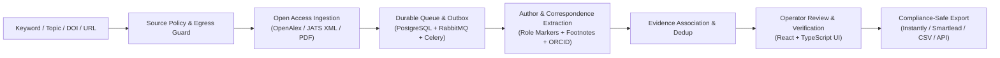

# EmailMonitor

**High-precision, evidence-backed academic contact discovery and extraction engine for Open Access (OA) article publishers, journal editors, and scholarly societies.**

EmailMonitor discovers academic articles via keywords, DOIs, search results, or article/PDF URLs, traverses permitted full-text sources, and extracts verified author identities, correspondence designations, affiliations, and professional contact information—with cryptographic evidence and full provenance.

---

## Current Project Status

> **Status Update (2026-11-11):**  
> - **Staging Integration Candidate:** 299 commits across 70 pull requests staged on branch [`codex/checkpoint-recovered-focus-20261111`](https://github.com/APReddy-AutoBotz/EmailMonitor/pull/70) (PR #70).
> - **Verified Capabilities:** Tasks EM-001 through EM-013 are verified offline across 600+ tests—including multi-tenant PostgreSQL Row-Level Security (RLS), Celery/RabbitMQ transactional outbox, SSRF & DNS-pinned protected fetch, synthetic HTML/PDF/tooltip extraction, deterministic author-email association, formula-safe CSV/XLSX export, and a full React/Vite operator SPA.
> - **Next Production Milestones:** Resolving headless Chromium CI runner isolation, merging PR #70 into `main`, and onboarding direct Open Access APIs (OpenAlex, Europe PMC JATS XML, Crossref). See the [Open Access strategic roadmap](docs/25-open-access-strategic-roadmap.md) and [status ledger](docs/22-implementation-status.md).

---

## Why Open Access Publishers Need EmailMonitor

Open Access publishers and editors rely on targeted researcher outreach for:
1. **Special Issue / Thematic Collection Invitations (Call for Papers):** Identifying active authors in specific sub-disciplines with research budgets for Article Processing Charges (APCs).
2. **Editorial Board & Section Editor Recruitment:** Finding productive, reputable scholars to guide emerging journals.
3. **Peer Reviewer Discovery:** Matching submitted manuscripts with unconflicted domain experts who recently published on identical topics.
4. **Citation Outreach:** Informing cited authors of newly published Open Access articles.

### Why Generic Scrapers Fail (and Why EmailMonitor Wins)

| Generic Scraping Tools | EmailMonitor Solution |
|---|---|
| **Confuses Author Roles:** Sends APC invitations to junior PhD students or lab techs who cannot submit or pay. | **Role-Aware Extraction:** Strictly separates Lead Author, Senior Author, and **Corresponding Author**. Outreach is directed only to verified correspondence contacts. |
| **Hallucinates / Guesses Emails:** Uses regex permutations (`first.last@univ.edu`), generating bounces and spam blacklisting. | **Zero Guessed Emails:** Every contact requires verbatim textual evidence, cryptographic document hash, and exact offset. |
| **Blocks & CAPTCHAs:** Web crawlers trigger Cloudflare, Akamai, and IP bans. | **API-First & Protected Ingestion:** Prioritizes direct Open Access repository APIs (OpenAlex, Europe PMC JATS XML, Crossref) with sandboxed browser fallback. |
| **Legal & Privacy Vulnerability:** Violates EU/UK GDPR and CAN-SPAM regulations. | **Compliance-Ready:** Automatically generates a "Legitimate Interest" audit trail linking the contact to their public academic publication, plus universal suppression management. |

---

## Architecture & Workflow



### Core Architecture Highlights

- **Modular FastAPI Monolith:** Clear domain boundaries for `administration`, `associations`, `discovery`, `extraction`, `fetching`, `identity`, `jobs`, `lifecycle`, `operator`, `organizations`, `parsing`, `progress`, `results`, `runtime`, and `sources`.
- **True Multi-Tenancy:** Day-one PostgreSQL Row-Level Security (RLS) with non-owner runtime database roles; zero cross-tenant leakage.
- **Fail-Closed Protected Fetch Gateway:** Strict egress filtering, connection-time IP validation, synthetic DNS pinning, and SSRF prevention.
- **Resilient Background Execution:** Celery workers backed by RabbitMQ with transactional outbox, idempotent leases, and resumable checkpoints.
- **Modern Operator UI:** React 18 + TypeScript + Vite SPA featuring dual input wizards (keyword and URL modes), live SSE progress tracking, interactive evidence drawer, candidate association unlink/review, contextual suppression, and formula-safe export downloads.

---

## The "Sure-Shot Success" Blueprint

To establish EmailMonitor as the undisputed gold standard for Open Access publishers, the project roadmap includes six high-impact pillars:

1. **Direct Open Access REST & XML Ingestion (Zero-Scrape):** Native connectors for **OpenAlex** (250M+ works), **Europe PMC & PubMed Central** (full-text JATS XML), **Crossref**, and **arXiv / bioRxiv** preprints. 100x faster, zero bot blocks, 100% legal.
2. **First-Class JATS XML Engine:** Direct parsing of standard academic `<contrib-group>`, `<contrib corresp="yes">`, and `<corresp><email>` tags for 99.9% correspondence precision.
3. **Researcher Recency & Activity Scoring:** Filters authors active in the past 12–24 months, verifies live MX domain health, and disambiguates scholars via ORCID.
4. **1-Click Outreach Presets:** Export profiles formatted specifically for cold email engines (Instantly.ai, Smartlead, Lemlist, HubSpot) with auto-mapped tags (`{{First_Name}}`, `{{Paper_Title}}`, `{{Journal}}`, `{{DOI}}`).
5. **Universal Suppression & GDPR Defense Hub:** Tenant-wide unsubscribe management and instant Legitimate Interest audit certificates.
6. **Smart Subject Sourcing:** Discovery powered by MeSH (Medical Subject Headings) terms, OpenAlex Concept IDs, and journal ISSN filtering.

For full technical specifications and phase-by-phase timelines, see [docs/25-open-access-strategic-roadmap.md](docs/25-open-access-strategic-roadmap.md).

---

## Repository Documentation Map

- **Product & Business:** [Product Charter](docs/00-product-charter.md) | [Business Requirements](docs/01-business-requirements.md) | [Product Requirements](docs/02-product-requirements.md) | [Open Access Strategic Roadmap](docs/25-open-access-strategic-roadmap.md)
- **Architecture & Security:** [Architecture Specification](docs/04-architecture.md) | [Multi-Tenancy & Access](docs/05-multitenancy-and-access.md) | [Threat Model & Security](docs/11-security-and-threat-model.md) | [ADR Index](docs/adr/0001-architecture-and-stack.md)
- **Connectors & Extraction:** [Crawling & Connectors](docs/06-crawling-and-source-connectors.md) | [Extraction & Identity](docs/07-extraction-and-identity.md) | [Source Onboarding Playbook](docs/23-source-onboarding-playbook.md)
- **Validation & Delivery:** [Delivery Backlog](docs/16-delivery-backlog.md) | [Acceptance & Traceability](docs/17-acceptance-and-traceability.md) | [Implementation Status Ledger](docs/22-implementation-status.md)
- **Schemas & Contracts:** Normative JSON schemas and examples in [contracts/](contracts/README.md).

---

## Development & Local Setup

### Documentation Validation
Validate markdown cross-references, JSON schemas, examples, and requirement traceability:

```sh
pip install -r scripts/requirements-docs.txt
python scripts/validate_docs.py
```

### Staged Application Environment (Branch: `codex/checkpoint-recovered-focus-20261111`)

The scaffolded application stack requires **Python 3.12+**, **Node 20+**, **uv**, and **pnpm**:

```sh
# 1. Install Backend Dependencies
uv sync --project services/backend --locked

# 2. Install Frontend Dependencies
pnpm --dir apps/web install --frozen-lockfile --strict-peer-dependencies

# 3. Run Backend API Server
uv run --project services/backend uvicorn emailmonitor.api:app --app-dir services/backend/src --host 127.0.0.1 --port 8000

# 4. Run Frontend Development Server
pnpm --dir apps/web dev
```

Visit `http://localhost:5173` to interact with the Operator UI.

---

## Security & Ethical Principles

- **No Guessed Contacts:** EmailMonitor strictly extracts observed, published contact data; it never fabricates or hallucinates emails.
- **Fail-Closed Egress:** All outbound network connections pass through the protected fetch boundary; no SSRF, private IP scanning, or credential forwarding.
- **Tenant Isolation:** Client-supplied organization IDs are never trusted; all operations are bound to server-authenticated tenant sessions with PostgreSQL RLS.
- **Respect for Access Controls:** EmailMonitor does not bypass CAPTCHAs, paywalls, or login requirements.
